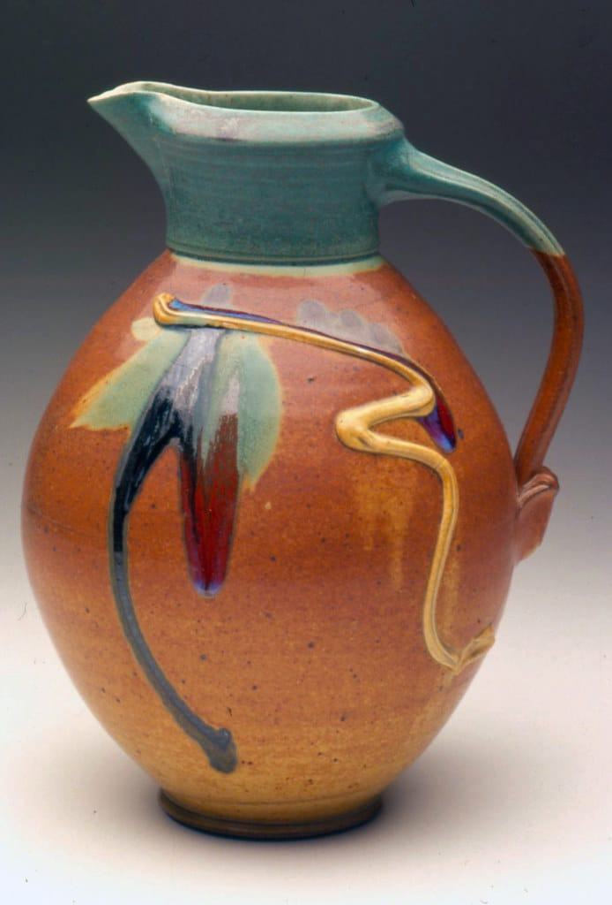

In the rush to launch, iterate, and scale, craft in digital product design often feels like an afterthought. But craft isn’t a romantic relic, it’s the foundation of exceptional design. It’s what separates forgettable, disposable products from those that feel truly thoughtful, purposeful, and worth using regularly.

I know a little about craft, having been a **professional studio potter** for 20 years prior to becoming a digital product designer.

## Craft is More than Pixel Perfection

When designers talk about craft, it’s easy to default to aesthetics: clean grids, crisp typography, and flawless alignment. But craft goes deeper. It’s about how a product works, how it feels, and, most importantly, how it respects the user’s time, attention, and needs.

As a potter, I wanted the pieces I made to be not just **beautiful but useful**. In the same way, I want the digital products I design to provide an **exceptional user experience**.

Craft is in the details that intuitively guide users. It’s in the logical flow of a checkout process that doesn’t make you want to throw your phone out the window. It’s in the considered use of animation, not as decoration but as a way to guide a user though a complex flow. A well-crafted digital product doesn’t scream for attention—it does its job without fanfare.

## Don’t Just Ship It

As design tools evolve and workflows speed up, the pressure to “just ship it” increases. We copy, paste, and remix design systems at breakneck speed, often without stopping to clearly ask what the problem is that this “design solution” is intended to solve. Craft demands pausing, asking why, and making deliberate decisions as we evolve our designs.

When craft is sacrificed to save time, the cracks show: clunky user experiences and an incoherent user flow, which makes the interactions feel generic and lifeless. Users may not have the vocabulary to articulate what’s wrong, but they know it.

## Why Craft Matters More Than Ever

In a world saturated with apps, websites, and tools, the bar for exceptional user experiences keeps rising. Mediocre design fades into noise, while products built with craft stand out. They build trust, loyalty, and even delight.

Consider the products you genuinely love—those you return to because they just work. Odds are, they didn’t get there by accident. Behind the scenes, a designer obsessed over the details most people will not notice but that contribute to the product’s excellence.

## Craft is a Mindset

Craft is not about unlimited time or budgets, it’s about a mindset of caring to ask whether this design solution will create the best user experience and even delight a user.

It’s about balancing speed with thoughtfulness. You might have a tight deadline, but it’s still crucial to understand your constraints and choose the best design solutions within them. Instead of designing on autopilot, craft forces you to engage with your work.

## Bring Craft Back

So, how do we bring craft back to the forefront of digital product design?

- **Start With Empathy:**  Understand your users. Craft begins with solving the right problems.
- **Slow Down:**  Take time to think creatively and critically. Push back against timelines that don’t leave room for this way of working.
- **Obsess Over Details:**  The devil—and the magic—is in the details. Test your work. Question every design component. Iterate until it feels right.
- **Be Curious:**  Don’t just follow existing patterns, explore why they work. Innovate when necessary, but don’t reinvent the wheel for its own sake.

## Craft is the Future

In digital product design, craft isn’t just a nice-to-have. It’s the difference between forgettable and indispensable. It’s what transforms a service into a seamless experience and a product into one that’s a delight to use.

Craft is the antidote to sameness, the cure for mediocrity, and the secret sauce for digital products that people can’t stop talking about and using. **If you’re not prioritizing it, your competitors probably are.**
