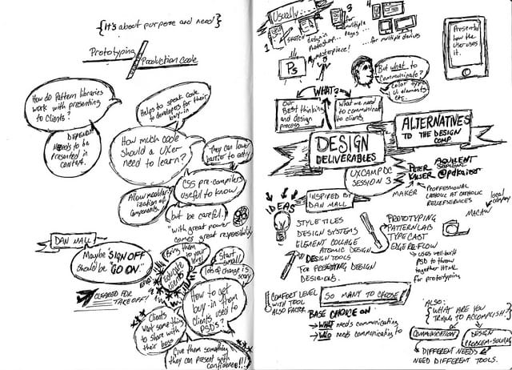

Happy New Year! To get the new year off on the right user experience foot the folks at [UX Camp DC](http://uxcampdc.com/) held their annual UX Bar Camp this past Saturday January 3rd. I had attended their September Mobile UX Camp and enjoyed it so I decided to attend and do a presentation on [Design Deliverables](http://peterkaizer.com/design-deliverables/) which is something I have been thinking about for a while now.

The event was well attended and my presentation drew a decent crowd. Here is the presentation:

Many thanks to [Patricia Kruep](https://twitter.com/littleberry) who did this very nice sketch note of the presentation.

In addition to my presentation there were many other really great ones including my [Aquilent](http://aquilent.com/) colleague [Jeff Pass](https://twitter.com/jeffpass) who did a really great one titled ["Towards a continuous UX improvement model"](http://lanyrd.com/2015/uxcampdc/sdhcmt/)
